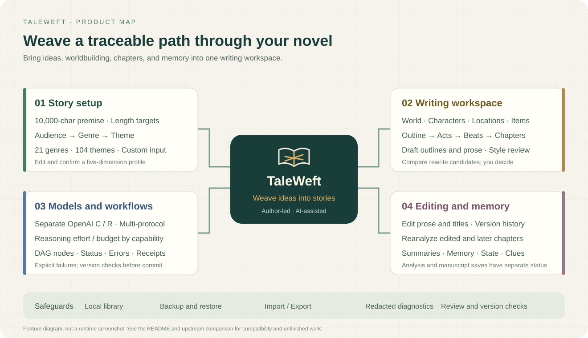
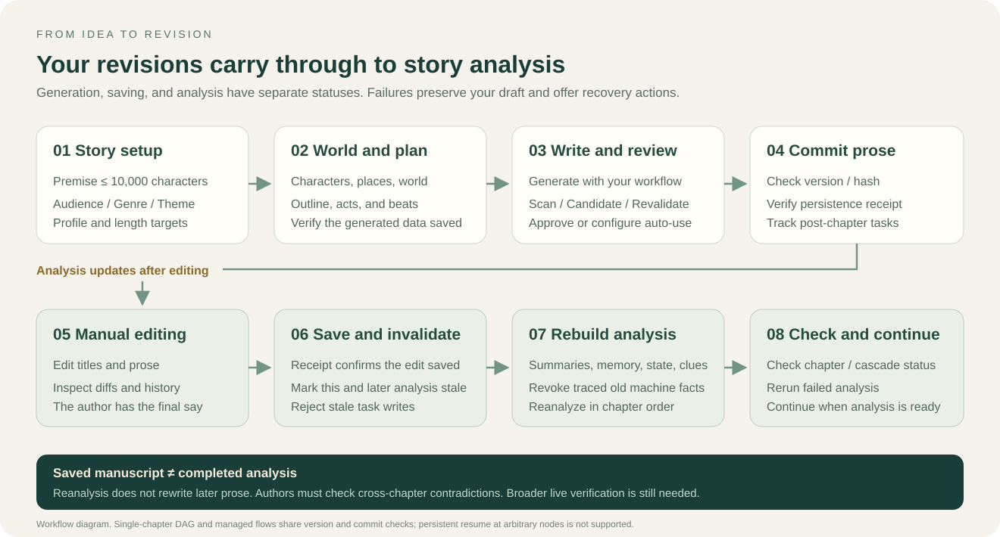
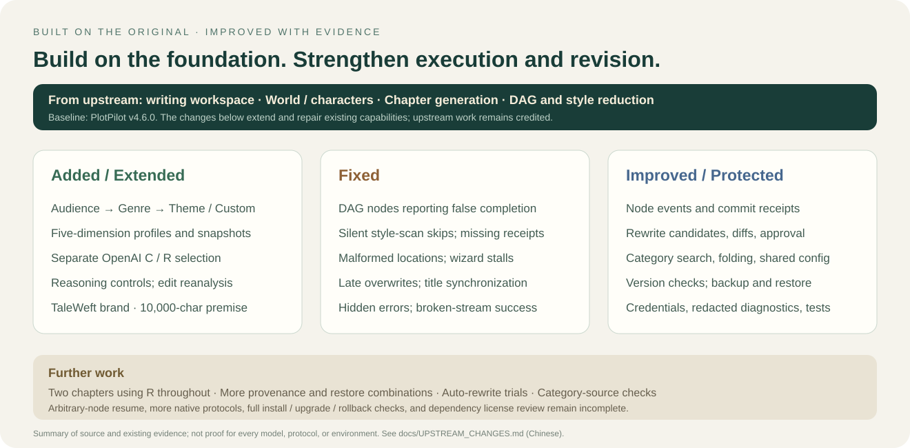

<div align="center">

[简体中文](README.md) · **English**


# TaleWeft · 叙织

**Weave your ideas into stories.**

An AI writing workspace for long-form fiction, connecting ideas, worldbuilding, chapters, and story memory in one place.

[Download](https://github.com/MontellaGreat/TaleWeft/releases) · [User guide (Chinese)](docs/USER_GUIDE.md) · [Features](#features) · [Changes from upstream](#changes) · [Documentation (Chinese)](docs/README.md)

Local manuscript library · Guided genre selection · Multiple model protocols · Traceable workflows

</div>

TaleWeft helps authors maintain fictional worlds, character relationships, and continuity across chapters. Set the direction of your story, plan and generate it, edit whenever you need to, and track the analysis triggered by your changes. You make the creative decisions; AI helps organize, develop, and review the story.

This project is independently modified and maintained from [PlotPilot v4.6.0](https://github.com/shenminglinyi/PlotPilot/tree/v4.6.0), under a separate brand, with no affiliation with or endorsement from the original team. The current independent release is **0.1.0-preview.1**. See the [release notes (Chinese)](docs/RELEASE_0.1.0-preview.1.md) for the distributed assets and verification scope.

This is the English README. The screenshot below shows the current Chinese interface; the linked detailed guides are in Chinese unless otherwise marked.


This is an actual browser screenshot of the author's desk, showing a sample story written for testing. It contains no private manuscripts or model credentials. The application uses the official woven-page book logo. The mind map and workflow diagrams below explain its features.



<a id="features"></a>

## What you can do

| Writing stage | Capabilities |
| --- | --- |
| Story setup and genre selection | Enter a premise of up to **10,000 characters**; choose male-reader, female-reader, or shared-audience categories, then a genre and theme, or enter your own categories |
| Writing rules | Edit and confirm five dimensions: worldbuilding tone, plot structure, pacing, writing style, and special requirements; save a separate profile snapshot for the book |
| Worldbuilding and planning | Manage the world, characters, locations, and key items; organize the overall outline, acts, beats, and chapters |
| Chapter writing | Generate chapter outlines and prose through fully managed or DAG workflows; inspect stages, node results, and failure reasons |
| Style review | Scan only, generate rewrite candidates for approval, or automatically adopt candidates that pass revalidation when configured; compare the original with the proposed rewrite |
| Manual editing | Edit chapter titles and prose, inspect version history, and track recalculation tasks for the edited chapter and later chapters after saving |
| Model configuration | Select OpenAI C / Chat Completions and OpenAI R / Responses separately, or use Anthropic Messages and Gemini generateContent; configure reasoning parameters according to model capabilities |
| Data management | Back up and restore the database, migrate JSON manuscripts, and export Markdown / DOCX / EPUB / PDF; manage credentials and export redacted diagnostics |

<a id="quick-start"></a>

## Quick start

### Windows installer

Open the [v0.1.0-preview.1 download page](https://github.com/MontellaGreat/TaleWeft/releases/tag/v0.1.0-preview.1), download `TaleWeft-0.1.0-preview.1-x64-setup.exe`, and verify its SHA-256 against `SHA256SUMS.txt`. GitHub's automatically generated Source code archives contain the source.

The installer includes no model credentials or private manuscript library from the development machine. Configure your own model service after installation, then try the sample book or a new test project. Full instructions are in the [Chinese user guide](docs/USER_GUIDE.md).

To try editing and manuscript import first, download the public [six-chapter sample manuscript](examples/fog-harbor.taleweft.json). In the application, open the manuscript JSON import dialog (稿件 JSON 导入), preview it, and confirm. This requires neither Python nor an API key. It contains two chapters of sample prose and four empty chapters. The Release also includes a complete sample library and an isolated launcher, with characters, locations, items, foreshadowing, and story structure. See the [sample instructions (Chinese)](examples/README.md) for launch steps and importing from source.

### Run from source

You need **Python 3.14**, **Node.js ≥ 22.12.0**, and npm. Run the following in PowerShell from the project root. The virtual environment and download caches stay inside the project:

```powershell
py -3.14 -m venv .venv
.\.venv\Scripts\python.exe -m pip install --cache-dir .cache/pip --require-hashes -r requirements.lock

Push-Location frontend
npm.cmd ci --cache .cache/npm
npm.cmd run build
Pop-Location

.\.venv\Scripts\python.exe scripts/run_local_secure.py
```

The launcher starts the service on a local loopback address and opens a browser page with a private session. Press `Ctrl+C` to stop it. For development, use `scripts/run_local_secure.py --dev` to enable Vite. Run with `--help` to see the available options.

If you already have the Windows portable runtime, you can also use the compatibility launcher:

```powershell
.\tools\taleweft.bat
```

This launcher checks Python and prepares dependencies. When starting from a source-only download, build the frontend first using the steps above. For desktop installer builds, see [BUILD_INSTALLER.md (Chinese)](docs/BUILD_INSTALLER.md). Source code and installers are distributed separately; check the Release version and checksums to confirm what you downloaded.

### First use

1. Open Settings → Model engine (设置 → 模型引擎). Enter the provider, Base URL, model, and API key. Select the protocol your gateway actually supports and test the connection.
2. Enter your premise on the home page. Choose an audience channel, genre, and theme; review the five-dimension profile and target length, then create the book.
3. Follow the setup wizard to generate and confirm worldbuilding, characters, locations, and planning, then enter the writing workspace.
4. After writing, edit chapter titles and prose as needed. After saving, check the separate analysis status and rerun it if necessary.

Model and embedding services contact the providers you configure, and requests may incur charges. Local manuscript storage does not make model calls work offline. The material sent to a model depends on the features you enable.

<a id="usage"></a>

## From story setup to revision



### Choose categories or enter your own

The built-in catalog currently contains **21 genres and 104 web-fiction themes**, displayed progressively by audience channel, with search and expandable sections. The shared-audience channel uses a common catalog rather than maintaining two duplicate sets of themes. These audience channels reflect Chinese web-fiction market conventions.

- Audience channel → built-in genre → built-in theme.
- Audience channel → built-in genre → custom theme.
- Audience channel → custom genre → custom theme.

Each theme includes a five-dimension profile for the author to edit and confirm. Target platforms, topic tags, and reader expectations provide additional context without putting every possible combination into one oversized selector. This catalog supports creative planning. Some website mappings still need verification, and it does not represent every platform's complete, current categories.

### Where to adjust reasoning effort

Open **Settings → Model engine → the relevant model role → Reasoning effort and reasoning parameters** (设置 → 模型引擎 → 对应模型角色 → 思考程度与推理参数) and expand the section. The primary, economy, and knowledge-graph roles save their own parameters. Full settings are also available under **AI console → LLM settings → Select configuration profile** (AI 控制台 → LLM 设置 → 选择配置档案).

The OpenAI adapters expose reasoning effort; the Anthropic and Gemini adapters expose thinking budgets where supported. Leave a setting empty to use the model default. Available levels and parameter combinations differ by model and gateway. Unsupported configurations produce a warning or rejection. C and R call `/chat/completions` and `/responses` respectively. Explicitly selecting R does not silently fall back to C.

### How AI-style reduction works

Here, “AI-style reduction” means scanning prose against style rules and proposing rewrites. It does not promise to pass any detector or guarantee literary quality.

| Policy | Behavior |
| --- | --- |
| `scan_only` (default) | Scan and record issues without automatically adopting a rewrite |
| `review` | Generate and revalidate a candidate, then wait for the author to compare changes and approve |
| `auto` | Automatically adopt a candidate after it passes required revalidation, version checks, and commit checks |

“No rewrite needed” should have a scan result and a reason. A failed scan, a scan that never ran, an unavailable scan, or a missing execution receipt must not count as successful completion. See [manuscript protection and troubleshooting (Chinese)](docs/RECOVERY_AND_SUPPORT.md) for diagnosis and recovery.

### What updates after an edit

After you save a chapter title and prose, the system invalidates the relevant analysis for that chapter and later chapters, then recalculates machine-derived summaries, memory, character state, foreshadowing, and related material in chapter order. Manuscript saving, analysis of the edited chapter, and the cascade through later chapters have separate statuses. The version-history panel provides an action to rerun post-chapter analysis (重跑章后关联分析).

In the browser test recorded for this release, a title and prose edit to Chapter 1 persisted after refresh, appeared in history, and triggered sequential recalculation for Chapters 1 and 2. The new warehouse identifier entered memory, and the registered brass key's holder changed to Zhou Du. Chapter 3 was generated through R with 1,223 characters, saved, and read back after refresh; its post-chapter analysis subsequently completed through C.

**Recalculating related analysis does not automatically rewrite later chapters' prose.** For example, if you change an item identifier in Chapter 1 while Chapter 2 still uses the old identifier, you must check the contradiction in the manuscript. Automatic cleanup is also not guaranteed for historical data without known provenance. This test does not establish that every relationship type and multi-chapter combination has been verified. See [verification evidence and limits (Chinese)](docs/UPSTREAM_CHANGES.md#limits).

<a id="changes"></a>

## Changes from upstream



The upstream project already included a fiction workspace, worldbuilding management, chapter generation, DAGs, and AI-style reduction mechanisms. This version strengthens execution, adds execution receipts, fixes errors, and adds genre-selection interactions and editing safeguards around those existing capabilities.

| Area | Changes in this version |
| --- | --- |
| DAG execution | Stronger cycle and port validation, actual single-chapter execution, and node events; failures, cancellations, skipped downstream nodes, and commit results are shown separately |
| AI-style reduction | Connects pre-generation rules, prose scanning, post-chapter audits, and rewrite candidates; binds evidence to manuscript versions and fixes silent bypasses and false success reports |
| Model engine | Separate C / R selection; reasoning effort and budgets, sampling controls, and capability checks wired through the stack; SDK and URL compatibility fixes |
| Market categories | Audience channel → genre → theme, custom entries, search, and collapsible lists; editable five-dimension profiles with confirmation and version snapshots |
| Setup wizard | Normalizes malformed location trees while preserving hierarchy; explicit feedback for empty results, interrupted streams, failed saves, and polling failures, with retry support |
| Editing and related analysis | Synchronized chapter titles, version history, conflict and late-write protection, and save receipts; invalidation and recalculation for the edited chapter and later chapters |
| Data and stability | Stronger backup and restore, manuscript migration, credential protection, redacted diagnostics, and build verification; fixes for swallowed errors and incorrect terminal statuses |
| Author's desk | Library view, three-step book creation, global writing navigation, paper-style prose editor, chapter search, nine reference panels, focus mode, and three themes; existing business panels and actions retained |
| Branding and premise limit | Independent “TaleWeft · 叙织” branding and the official woven-page book logo; new-book premise limit increased from 2,000 to 10,000 characters, validated consistently in the frontend and backend |

For the detailed “original issue → change → current behavior → verification limits” comparison, see [UPSTREAM_CHANGES.md (Chinese)](docs/UPSTREAM_CHANGES.md). For branding and compatibility identifiers, see [MODIFICATIONS.md (Chinese)](MODIFICATIONS.md).

Further work includes a complete two-chapter flow using R throughout, more relationship types and data-provenance combinations, sources for some website categories, persistent resume from arbitrary workflow nodes, more native provider protocols, and further installation, upgrade, and rollback acceptance testing. The style prompts and scanning have evidence of actual execution; the optional automatic rewrite path was not part of this live test. Literary results and whole-book semantic consistency require human evaluation.

## Data and migration

| Run mode | Default manuscript data location |
| --- | --- |
| Local source run | `data/` inside the project |
| Independent desktop application | `%APPDATA%\com.taleweft.desktop\data` |
| Custom | Set `TALEWEFT_PROD_DATA_DIR` before launch; the legacy variable remains a fallback |

The new brand uses a separate application identifier and does not automatically copy or overwrite the original application's data. Before migrating, create and verify a backup in the original version, then follow the [recovery instructions (Chinese)](docs/RECOVERY_AND_SUPPORT.md) to import a manuscript or restore a database. Do not let multiple instances write to the same database at once.

The database name, JSON manuscript format, and some internal keys retain compatibility identifiers. External Qdrant data, asset files, and credentials used across machines have separate backup limitations. Windows credentials generally need to be entered again when changing computers or users.

## Development and verification

The frontend uses Vue 3, TypeScript, Naive UI, and Pinia. The backend uses FastAPI, Python, and SQLite; the desktop shell uses Tauri. Business code is organized into `domain/`, `application/`, `infrastructure/`, and `interfaces/`. The `engine/` directory contains the execution core, and `shared/` holds shared category configuration.

```powershell
# Project root: run premise-boundary and persistence tests with isolated data
$env:PLOTPILOT_PROD_DATA_DIR = Join-Path $PWD 'out/readme-refresh/test-data'
$env:LOG_FILE = Join-Path $PWD 'out/readme-refresh/test-data/test.log'
Remove-Item Env:TALEWEFT_PROD_DATA_DIR -ErrorAction SilentlyContinue
.\.venv\Scripts\python.exe -m pytest tests/integration/test_novel_premise_limit.py -q

Push-Location frontend
npm.cmd run test:unit
npm.cmd run build
Pop-Location
```

Select additional tests according to the modules you change. Passing automated tests does not establish that every model and installation environment has passed a real end-to-end flow. See the [documentation index (Chinese)](docs/README.md) for architecture and build instructions.

## Documentation and contributing

The detailed documents below are currently in Chinese.

| Document | Contents |
| --- | --- |
| [User guide](docs/USER_GUIDE.md) | Installation, book creation, model parameters, editing and related analysis, workflows, backups, and feedback |
| [v0.1.0-preview.1 release notes](docs/RELEASE_0.1.0-preview.1.md) | Features, actual test records, and known limits |
| [Architecture](docs/ARCHITECTURE.md) | Layers, execution core, and data flow |
| [Upstream comparison](docs/UPSTREAM_CHANGES.md) | Additions, fixes, improvements, and areas awaiting verification |
| [Recovery and troubleshooting](docs/RECOVERY_AND_SUPPORT.md) | Manuscript protection, backups, style-reduction status, and redacted diagnostics |
| [Installer build](docs/BUILD_INSTALLER.md) | Frozen backend, Tauri, and isolated acceptance testing |
| [Embedding model configuration](docs/embedding_model_download_guide.md) | Optional local embedding models |
| [Logo prompts](docs/branding/叙织-TaleWeft-Logo生成提示词.md) | Prompts and integration references for a 1:1 logo; the current application uses the official woven-page book logo supplied by the user |
| [README references](docs/README_REFERENCES.md) | Structural references from Dify, Open WebUI, and uv, and how they were adapted |

Report reproducible problems and suggestions through [GitHub Issues](https://github.com/MontellaGreat/TaleWeft/issues). Include the version / build ID, steps to reproduce, expected and actual behavior, and reviewed, redacted diagnostics. When contributing a change, describe how you verified it. Do not submit API keys, session links, private manuscript libraries, or unreviewed full logs.

## Origins, acknowledgments, and license

Thank you to the original [PlotPilot](https://github.com/shenminglinyi/PlotPilot) authors and [contributors](CONTRIBUTORS.md) for the foundation. This version is independently maintained; see [NOTICE](NOTICE) for attribution. The README diagrams were created for this project. Logos, screenshots, and brand assets from the reference projects were not copied.

This project retains **Apache License 2.0 + Commons Clause License Condition v1.0**, including restrictions on charging for the software and related services. It must not be treated as plain Apache 2.0 or unconditional commercial permission. Read the complete [LICENSE](LICENSE) and the [modification statement (Chinese)](MODIFICATIONS.md).

Third-party components have their own licenses. EPUB export uses MIT-licensed `epublib`; PDF export uses LGPL-3.0-only `fpdf2`. Releases include the corresponding license texts and source-replacement instructions. The provenance of the statically linked dependencies in the lxml Windows native extension and the full rebuild path remain subject to the limitations documented in `THIRD_PARTY_NOTICES/`. The inventory is not legal advice. Rebranding does not change any license conditions.
