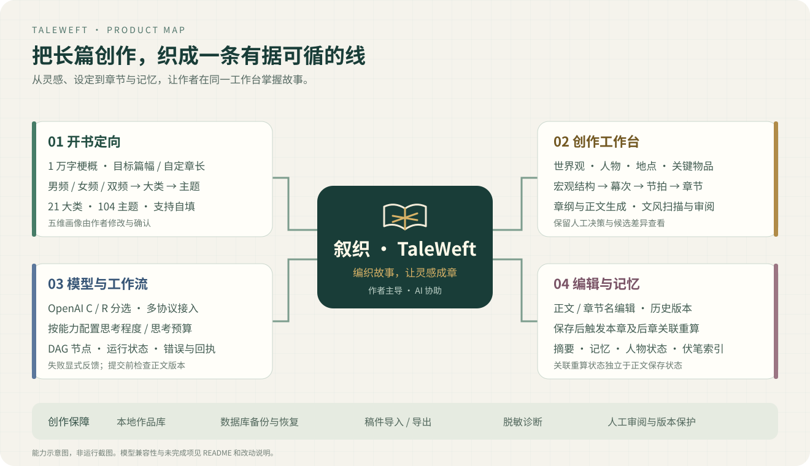

<div align="center">

**简体中文** · [English](README.en.md)


# 叙织 · TaleWeft

**编织故事，让灵感成章。**

面向长篇小说的 AI 创作工作台，让灵感、设定、章节和记忆在同一处衔接。

[下载安装](https://github.com/MontellaGreat/TaleWeft/releases) · [使用指南](docs/USER_GUIDE.md) · [功能一览](#features) · [相对原版的改动](#changes) · [更新日志](更新日志.md) · [文档](docs/README.md)

本地作品库 · 分级选题 · 多协议模型 · 可追踪工作流

</div>

叙织服务于需要持续维护世界设定、人物关系和章节连续性的作者：先明确故事方向，再规划与生成，随时介入修改，并跟踪修改后的关联分析。你决定故事，AI 协助组织、推演与审阅。

本项目基于 [PlotPilot v4.6.0](https://github.com/shenminglinyi/PlotPilot/tree/v4.6.0) 独立修改维护，使用独立品牌，与原团队无隶属或背书关系。本轮源码面向 **0.2.0**，汇总首次 GitHub 版之后的模型自动协议、本地嵌入、新书审核与恢复、作品支撑和提示词管理更新；改动及验证边界见[0.2.0 发布说明](docs/RELEASE_0.2.0.md)和[历史问题复查](docs/RECHECK_2026-10-26.md)。安装包构建与发布状态以对应校验回执及 Release 附件为准。


上图为当前作者书桌的真实浏览器截图，展示自编测试作品，不含用户作品或模型凭据。应用已接入正式「织页书标」；下方思维导图和流程图用于说明功能。



<a id="features"></a>

## 能做什么

| 创作环节 | 你可以做什么 |
| --- | --- |
| 开书与选题 | 输入最多 **10000 字**的故事梗概；按男频 / 女频 / 双频选择大类和主题，或填写自己的分类 |
| 写作规则 | 修改并确认世界观基调、剧情结构、节奏把控、写作风格、特殊要求五维画像，保存为本书独立快照 |
| 设定与规划 | 管理世界观、人物、地点、关键物品，组织总纲、幕次、节拍与章节 |
| 章节创作 | 生成章纲与正文，使用全托管或 DAG 流程，查看阶段、节点结果和失败原因 |
| 文风审阅 | 选择仅扫描、生成改写候选等待确认，或按配置自动采用通过复验的候选；查看原稿与改稿差异 |
| 手动编辑 | 修改章节名和正文，查看历史版本；保存后跟踪本章及后章的关联重算任务 |
| 作品支撑 | 完整编辑创作契约、文风与梗概锁；编辑角色档案、改名及删除，查看关联分析提交状态 |
| 提示词管理 | 查看模板实际用途；删除没有引用的自定义提示词；调整共享语义审稿的附加文风规范 |
| 模型配置 | 选择 OpenAI 自动、Anthropic Messages 或 Gemini generateContent；拉取模型后直接选择，按模型能力设置思考参数 |
| 数据管理 | 数据库备份与恢复、JSON 稿件迁移，以及 Markdown / DOCX / EPUB / PDF 导出；提供凭据管理和脱敏诊断 |

<a id="quick-start"></a>

## 快速开始

### Windows 安装包

**当前版本：0.2.0**。请在 [v0.2.0 下载页](https://github.com/MontellaGreat/TaleWeft/releases/tag/v0.2.0) 获取 `TaleWeft-0.2.0-x64-setup.exe`，并按同页 `SHA256SUMS.txt` 校验。安装包大小、SHA-256、测试结果和验证范围见[0.2.0 发布说明](docs/RELEASE_0.2.0.md)。源码 ZIP、完整更新日志和公开构建校验记录作为独立附件提供；GitHub 自动生成的 Source code 压缩包也可用于获取源码。

历史公开安装包仍见 [v0.1.0-preview.1 下载页](https://github.com/MontellaGreat/TaleWeft/releases/tag/v0.1.0-preview.1)，按该 Release 的 `SHA256SUMS.txt` 校验。已验证的历史本地包 `TaleWeft-0.1.0-preview.16-x64-setup.exe` 及其 `.sha256`、`.verification.json` 记录保留，详见 [preview.16 发布说明](docs/RELEASE_0.1.0-preview.16.md)；它们不替代 0.2.0 的校验。

安装包不附带开发机模型凭据或私人作品库。安装后先填写自己的模型服务配置，再用测试书或新建测试作品试写。完整步骤见[中文使用指南](docs/USER_GUIDE.md)。

想先体验编辑和稿件导入，可下载公开自编的[六章示例稿件](examples/fog-harbor.taleweft.json)，在软件的“稿件 JSON 导入”入口预览并确认，无需 Python 或 API Key。它包含 2 章样稿与 4 章空稿。历史 [preview.1 Release](https://github.com/MontellaGreat/TaleWeft/releases/tag/v0.1.0-preview.1) 还提供完整测试书库和隔离启动器，含人物、地点、道具、伏笔与结构；启动步骤和源码导入方式见[示例说明](examples/README.md)。

### 从源码运行

需要 **Python 3.14**、**Node.js ≥ 22.12.0** 和 npm。以下在项目根目录用 PowerShell 执行，虚拟环境与下载缓存均放在项目内：

```powershell
py -3.14 -m venv .venv
.\.venv\Scripts\python.exe -m pip install --cache-dir .cache/pip --require-hashes -r requirements.lock

Push-Location frontend
npm.cmd ci --cache .cache/npm
npm.cmd run build
Pop-Location

.\.venv\Scripts\python.exe scripts/run_local_secure.py
```

启动器会在本机回环地址启动服务，并打开携带私有会话的浏览器页面。按 `Ctrl+C` 停止。开发时可改用 `scripts/run_local_secure.py --dev` 启用 Vite；参数说明用 `--help` 查看。

已有 Windows 便携运行环境时，也可使用兼容启动入口：

```powershell
.\tools\taleweft.bat
```

该入口会检查 Python 并准备依赖；从纯源码下载时仍建议按上面的步骤先构建前端。桌面安装器构建见 [BUILD_INSTALLER.md](docs/BUILD_INSTALLER.md)。源码与安装包分别交付，请按 Release 版本与校验值确认下载内容。

### 首次使用

1. 在“设置 → 模型引擎”填写服务商、Base URL、模型与 API Key，选择网关实际支持的协议并测试连接。
2. 在首页输入梗概，选择频道、大类、主题，核对五维画像与目标篇幅，然后建档。
3. 按开书向导生成并确认设定、人物、地点与规划，再进入工作台写作。
4. 写完后可修改章名与正文；保存后单独查看关联分析状态，必要时重跑。

模型服务和嵌入服务按配置访问对应提供商，相关请求可能计费。本地保存作品不表示模型调用离线；提交给模型的内容以实际启用的功能为准。

<a id="usage"></a>

## 从开书到修改


### 分类可以选，也可以自己写

当前内置目录包含 **21 个大类、104 个网文主题**，按频道逐层展示，提供搜索、展开与收起。双频使用共享目录，不重复维护两套相同主题。

- 频道 → 内置大类 → 内置主题。
- 频道 → 内置大类 → 自填主题。
- 频道 → 自填大类 → 自填主题。

每个主题都带五维画像，作者可修改后确认。目标平台、题材标签和读者预期作为补充，避免把所有组合挤进一个巨大选择器。当前目录是产品的创作分类，部分网站映射仍待核验，不能等同于各平台实时完整分类。

### 思考程度在哪里调整

打开 **模型控制台 → LLM 设置 → 选择配置档案**，在**模型名正下方**调整思考程度或思考预算。也可在 **设置 → 模型引擎 → 对应模型角色 → 思考程度与推理参数**中调整；主力、经济、知识图谱角色分别保存自己的参数。

点击“创建第一本书”或“新建书目”会检查语言模型和嵌入模型配置，未就绪时提示并打开模型控制台。嵌入模型默认采用本地 BGE；点击“下载并准备本地模型”会自动准备依赖与权重，优先魔搭国内源，失败后切换 HF 镜像和官方源。已有云端嵌入配置继续保留。完整步骤见[嵌入模型配置](docs/embedding_model_download_guide.md)。

OpenAI 分支提供思考程度，Anthropic / Gemini 分支按适配能力提供思考预算；留空采用模型默认值。不同模型、网关的档位和参数组合不同，不支持的配置会被提示或拒绝。当前源码将 C / R 合并为 **OpenAI 自动**：优先使用 Responses，仅在确定端点不受支持且尚未输出时尝试 Chat Completions。鉴权、限流、502 和超时会保留真实错误。已移除厂商预设导入和档案预设选择。

### 新书生成进度与 DAG

文风 / 世界观 → 人物 → 地图 → 剧情总纲。世界观按 **核心法则 → 地理生态 → 社会结构 → 历史文化 → 沉浸感细节** 逐项生成，后项带入已审核保存的前项。文风及每个单元都执行结构校验、偏离检测与修复、Anti-AI 审计与修复、保存和回读，五维结束后再整体复审。世界观 48 个节点，其他阶段各 7 个节点。

向导显示进度条、当前动作、耗时与错误；**查看 DAG 工作流** 直接使用写作页的同一画布，四阶段均可点击节点和审核入口查看报告。新版流程定义与历史执行图分别展示，旧记录缺少审核时明确提示，不补造通过状态。失败或重启后可 **继续生成**，保留候选和已成功步骤；**从头重新生成** 需要确认。审核与保存完整完成前只读，完成后保留编辑与确认，修改会进入后续提示词。关闭向导只停止观察，**停止生成**才取消任务。进度按完成节点计算，不估算剩余时间。详见[分步工作流与恢复](docs/RELEASE_0.1.0-preview.4.md)和[审核展示与详情修复](docs/RELEASE_0.1.0-preview.5.md)。

preview.6 修复结构化市场画像下的内部提示词校验误报。生成、偏离审计和修复各自冻结提示词及证据；符合旧版已知故障的任务可点击“继续生成”恢复。真实修改市场画像仍需重新生成当前阶段，避免沿用过期审核。详见[市场画像校验修复](docs/RELEASE_0.1.0-preview.6.md)。

preview.7 支持模型返回结构化文风，修复内容完整却提示“文风公约为空”的问题。对象、列表及 JSON 文风转换为可读条目，旧失败任务可继续并重新审核，审核报告和接口错误仍会被拒绝。详见[文风规范化与恢复](docs/RELEASE_0.1.0-preview.7.md)。

### 去 AI 味会怎样运行

这里的“去 AI 味”指文风规则扫描与候选改写，不代表通过任何检测器或保证文学质量。

| 策略 | 行为 |
| --- | --- |
| `scan_only`（默认） | 扫描并记录问题，不主动采用改写 |
| `review` | 生成候选并复验，等待作者查看差异和确认 |
| `auto` | 候选通过必要复验、版本与提交检查后自动采用 |

“无需改写”应有扫描结果和原因。扫描失败、未运行、不可用或回执缺失，不能当作正常完成。排查和恢复见[正文保护与故障反馈](docs/RECOVERY_AND_SUPPORT.md)。

当前审稿与相关修复采用作者指定的段落规则：按实际换行划分自然段，每段最多一个中文句号，需要时在段末收束；保留事实、因果、否定和对白，不机械替换标点或拆碎段落。标题、名称及问号、叹号结尾无需强补句号。这是提示词和审稿规范，尚无独立句号计数硬拦截；旧自动写作格式分支的边界见[0.2.0 发布说明](docs/RELEASE_0.2.0.md)。

### 修改后会更新什么

保存章名和正文后，系统会使本章及后章相关分析过期，并按章顺序重算摘要、记忆、人物状态、伏笔等机器派生内容。正文保存、本章分析、后章级联分别记录状态；历史版本面板提供“重跑章后关联分析”。

历史隔离页面测试记录中，第一章改名改稿后刷新读回、历史留痕、本章与第二章顺序重算均完成；新仓库编号进入记忆，已登记铜钥匙的持有人更新为周渡。第三章通过 R 生成 1,223 字符，保存和刷新读回成功，后续章后分析通过 C 完成。这是既有记录，不属于本轮 0.2.0 新增的真实模型验收。

**重算关联不会自动改写后章正文。** 例如第一章修改道具编号，第二章仍使用旧编号，作者仍需核对正文矛盾。来源不明的历史数据也无法保证自动清理；该次测试不等于所有关联类型与多章组合均已验收，详见[验证事实与边界](docs/UPSTREAM_CHANGES.md#limits)。

### 编辑作品支撑与角色

“作品支撑 → 创作契约”提供完整长文本编辑，短窗口内也可滚动查看并使用底部操作。题材、五维画像、目标篇幅、完整文风与梗概锁一起保存并回读；修改结构化五维画像需重新确认。生成、未完成的设定审核或章后分析正在运行时会阻止冲突写入，版本过期时保留编辑草稿并提示重新加载。

角色页可编辑档案、人物关系与声线。改名同步本书当前章节和当前关联资料，保留历史正文版本与审稿原始证据；保存后持久提交章后分析任务，进度及失败重跑入口在章节历史中。删除角色需确认，会清理出场配置、关系及当前角色记忆，保留已写章节正文，并阻止旧记忆重新建立已删除档案。保存成功与关联分析完成分别呈现，模型相关分析仍可能失败。

### 提示词是否实际生效

提示词广场会标明已接入调用、仅关联说明或按路径生效等用途。新建、导入提示词需由业务功能、调用规格或工作流明确引用；存在 DAG 关联本身不证明执行过该模板。无引用的自定义提示词可以确认删除，内置项和仍有工作流、变量、调用规格或历史调用引用的项会保留并说明原因。

新书及正文共享的 `semantic-style-v4` 语义审稿会读取 `anti-ai-chapter-audit` 当前激活版本，作为附加文风规范冻结到本次请求。固定核心继续要求五维审阅、完整覆盖、原文证据与有效 JSON；历史 v1/v2/v3 按当时快照核验。`cliche-scan` 自身未作为独立模型请求执行，它复用共享规则。详见 [preview.16 发布说明](docs/RELEASE_0.1.0-preview.16.md)。

### 叙事结构长时间显示生成中

preview.16 修复全托管宏观规划的状态展示与失败回执。现场曾在网关 502 后遗留“请求已编译”且没有持久失败回执，执行器反复等待已有请求，侧栏又把等待审阅误显示成正在生成。现在按持久请求和运行状态区分生成、等待处理、失败、停止及中断；流关闭后继续核对，收到的结构预览保留，侧栏在正式结构读回前不显示生成完成。侧栏“打开运行中心处理”可进入“检查并恢复 AI 请求”，查看记录后手动重试、继续或确认写入；打开入口和停止状态都不会自动追加模型调用。停止期间确认的恢复结果会持久保存，下次明确启动托管后复用并写入结构树。

<a id="changes"></a>

## 相对原版改了什么


上游已经具备小说工作台、设定管理、章节生成、DAG 与去 AI 味机制。本版围绕这些能力补执行、补回执、修错误，并增加分类交互与编辑保护。

| 模块 | 本版变化 |
| --- | --- |
| DAG 执行 | 补强无环和端口校验、真实单章执行与节点事件；失败、取消、下游跳过和提交结果分别呈现 |
| 去 AI 味 | 串联生成前规则、正文扫描、章后审计和候选改写；用正文版本绑定证据，修复静默绕过与假成功 |
| 模型引擎 | OpenAI 自动协议，保留 Anthropic / Gemini；贯通思考程度与预算、采样和能力检查，修复 SDK 与地址兼容问题 |
| 市场分类 | 频道 → 大类 → 主题、自填、搜索折叠；五维画像可编辑、确认并保存版本快照 |
| 开书向导 | 整理异常地点树并保留层级；空结果、断流、保存失败与轮询失败明确反馈，支持重试 |
| 编辑与关联 | 章名同步、版本历史、冲突与迟到写入保护、保存回执；编辑后本章及后章关联失效与重算 |
| 数据与稳定性 | 补强备份恢复、稿件迁移、凭据保护、脱敏诊断及构建验证，修复错误吞掉与终态误报 |
| 作者书桌 | 书库与三步新建、全局创作导航、纸张正文、章节搜索、九资料入口、专注模式与三主题；保留原业务面板和操作入口 |
| 品牌与本次调整 | 独立更名“叙织 · TaleWeft”，接入正式「织页书标」；新建书目梗概从 2000 字提升为 10000 字，前后端一致校验 |

详细的“原问题 → 修改 → 当前行为 → 验证边界”见 [UPSTREAM_CHANGES.md](docs/UPSTREAM_CHANGES.md)，品牌与兼容标识见 [MODIFICATIONS.md](MODIFICATIONS.md)。

当前仍需完善：全程仅用 Responses 的完整两章流程、更多关联类型与数据来源组合、部分网站分类来源、任意节点持久断点续跑、更多厂商原生协议和安装升级回滚验收。去味提示词与扫描有历史真实执行证据，既有实测未覆盖所有可选自动改写路径；文学效果与全书语义一致性需要人工评估。

## 数据与迁移

| 运行方式 | 默认作品数据位置 |
| --- | --- |
| 源码本地运行 | 项目内 `data/` |
| 独立桌面版 | `%APPDATA%\com.taleweft.desktop\data` |
| 自定义 | 启动前设置 `TALEWEFT_PROD_DATA_DIR`；兼容旧变量作为回退 |

新品牌使用独立应用标识，不自动复制或覆盖原应用数据。迁移前先在原版本创建并验证备份，再按[恢复说明](docs/RECOVERY_AND_SUPPORT.md)导入稿件或恢复数据库。不要让多个实例同时写同一数据库。

数据库名、JSON 稿件格式和部分内部键保留兼容标识。外部 Qdrant、素材文件和跨机器凭据另有备份边界；Windows 凭据换电脑或换用户后通常需要重新填写。

## 开发与验证

界面采用 Vue 3、TypeScript、Naive UI 与 Pinia；后端使用 FastAPI、Python 和 SQLite，桌面壳使用 Tauri。业务按 `domain/`、`application/`、`infrastructure/`、`interfaces/` 分层，`engine/` 承载运行内核，`shared/` 保存跨端分类配置。

```powershell
# 项目根目录：隔离数据运行本次梗概边界与持久化测试
$env:PLOTPILOT_PROD_DATA_DIR = Join-Path $PWD 'out/readme-refresh/test-data'
$env:LOG_FILE = Join-Path $PWD 'out/readme-refresh/test-data/test.log'
Remove-Item Env:TALEWEFT_PROD_DATA_DIR -ErrorAction SilentlyContinue
.\.venv\Scripts\python.exe -m pytest tests/integration/test_novel_premise_limit.py -q

Push-Location frontend
npm.cmd run test:unit
npm.cmd run build
Pop-Location
```

更多测试按修改模块选用；自动测试通过不等于所有模型和安装环境的真实全流程通过。架构与构建方式见[文档索引](docs/README.md)。

## 文档与参与

| 文档 | 内容 |
| --- | --- |
| [中文使用指南](docs/USER_GUIDE.md) | 安装、建书、模型参数、编辑关联、工作流、备份与反馈 |
| [v0.2.0 发布说明](docs/RELEASE_0.2.0.md) | 首次 GitHub 版后的累计更新、升级与恢复说明、当前构建校验状态 |
| [v0.1.0-preview.16 发布说明](docs/RELEASE_0.1.0-preview.16.md) | 作品支撑编辑、角色联动、提示词用途与删除保护、共享审稿 v4 |
| [v0.1.0-preview.1 发布说明](docs/RELEASE_0.1.0-preview.1.md) | 首次独立预览版功能、真实测试记录与已知边界 |
| [架构说明](docs/ARCHITECTURE.md) | 分层目录、运行内核与数据流 |
| [原版改动对照](docs/UPSTREAM_CHANGES.md) | 新增、修复、优化及尚未验收的部分 |
| [恢复与故障反馈](docs/RECOVERY_AND_SUPPORT.md) | 正文保护、备份、去味状态和脱敏诊断 |
| [安装器构建](docs/BUILD_INSTALLER.md) | 冻结后端、Tauri 与隔离验收 |
| [嵌入模型配置](docs/embedding_model_download_guide.md) | 可选本地向量模型 |
| [Logo 提示词](docs/branding/叙织-TaleWeft-Logo生成提示词.md) | 1:1 标识生成与接入参考；当前使用用户提供的正式「织页书标」 |
| [README 参考记录](docs/README_REFERENCES.md) | Dify、Open WebUI、uv 的结构参考与取舍 |

欢迎在 [GitHub Issues](https://github.com/MontellaGreat/TaleWeft/issues) 提交可复现的问题和改进。报告故障时附上版本 / build id、操作步骤、预期与实际结果，以及检查过的脱敏诊断；提交修改时说明验证方式。不要提交 API Key、会话链接、私人作品库或未审查的全文日志。

## 来源、致谢与许可

感谢 [PlotPilot](https://github.com/shenminglinyi/PlotPilot) 原作者与[贡献者](CONTRIBUTORS.md)提供的创作基础。本版独立维护，具体归属见 [NOTICE](NOTICE)。README 图示为本项目绘制，参考项目的 Logo、截图和品牌素材未复制使用。

本项目沿用 **Apache License 2.0 + Commons Clause License Condition v1.0**，包含对收费提供软件及相关服务的限制，不能视为纯 Apache 2.0 或无条件商用授权。全文见 [LICENSE](LICENSE)，修改声明见 [MODIFICATIONS.md](MODIFICATIONS.md)。

第三方组件遵循各自许可证。EPUB 导出使用 MIT 许可的 `epublib`，PDF 导出使用 LGPL-3.0-only 的 `fpdf2`，并随发行物提供相应许可与可替换源码说明；lxml Windows 原生扩展的静态依赖来源和完整重建路径仍按 `THIRD_PARTY_NOTICES/` 中的限制说明处理，不能把这份清单当作法律意见。品牌更名不改变任何许可条件。
