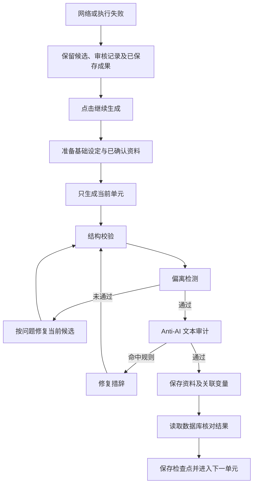

# 0.1.0-preview.4：可恢复的新书设置工作流

修改日期：2026-10-24。构建标识：`taleweft-0.1.0-preview.4-20261024`。包含 preview.3 的模型控制台、模型就绪检查及国内本地嵌入下载功能。

## 生成顺序

世界观不再用一个请求同时生成全部内容，改为依次生成并保存：

**文风公约 → 核心法则 → 地理生态 → 社会结构 → 历史文化 → 沉浸感细节 → 完整世界观复审**。

每次提示词只要求当前单元，并附带作者的基础简介、题材、特殊要求和已经审核保存的前置内容。后续单元必须遵守这些资料。五维全部保存后，再对完整世界观进行一次整体审核，必要时最小修正维度之间的冲突。

图中的“继续”会恢复当前单元和失败步骤；已成功完成且证据匹配的前置节点直接沿用。整体世界观复审复用已保存五维，不额外从零生成一套。人物、地图及剧情总纲也走完整的 **准备 → 生成 → 结构校验 → 偏离检测与修复 → Anti-AI 审计与修复 → 保存 → 回读**。

世界观共有 **48 个节点**，人物、地图和剧情总纲各 **7 个节点**，四阶段合计 **69 个节点**。进度条表示已完成节点比例，不表示剩余时间估算。

完整四阶段在不需要修复时包含 9 次内容生成和 10 次偏离审核，共 19 次模型调用；Anti-AI 规则扫描在本地执行，命中后才额外调用模型修复。相较一次性生成，请求次数增加，换取分步保存、可恢复和明确的质量门禁，实际耗时与费用取决于所用模型及修复次数。

## 审核与编辑规则

- 偏离检测由当前模型实际审阅基础简介、题材、特殊要求及前置资料；必须返回完整且与候选哈希匹配的报告。
- Anti-AI 复用写作工作流的扫描器，对 JSON 中可写作的文本字段逐项扫描；标识、名称、父地点 ID、章数等结构字段不作为正文扫描。必须确实完成扫描且无规则命中才可保存。
- 修复会创建新候选、使旧审核结果失效，并重新执行结构和两项审核；去味修复后也重新检查是否偏离。
- 每次运行中，每类修复最多进行两次；达到上限会明确失败并保留候选。点击“继续生成”可开启本次新的修复额度，网络失败不会永久耗尽修复次数。
- 当前阶段没有全部完成前，生成资料只能只读预览，不能保存修改、跳过或确认。API 同样检查门禁，避免通过其它界面或调用会话绕过。
- 后续阶段尚未完成时，作为其审核依据的前置资料也暂时锁定；界面提示应先继续哪个阶段。
- 完成保存及数据库回读后才解锁。整体复审修订过的单元保留原候选审核历史，同时记录整体修订回执。
- 旧版工作流没有这些审核契约，不因缺少新版记录而永久锁住原有书目。

Anti-AI 是基于规则的审计和按报告进行的模型修复，不能保证主观上完全消除“AI 味”；偏离审核的判断质量也依赖所用模型。软件保证审核确实执行并保存证据，审核失败时阻止误报完成。

## 失败恢复

- 候选、调用会话、审核报告、提交回执和前置基准写入 SQLite 检查点；不把模型凭据写入检查点。
- 生成、偏离审核、Anti-AI、保存或回读失败时均可继续；重建执行器后仍可恢复。
- 保存已经成功但响应丢失时，核对已有采纳与提交回执，避免重复生成或重复插入人物、地点。
- 保存到一半失败时，用持久化提交意图区分本次部分写入与外部改动。目标字段只能是提交前值或已审核候选值，其余前置资料和基础设定必须未变；继续时复用原提交 ID，完成关联变量保存，再全量回读。失败提交不会被伪装成已成功。
- 去味改写成功后偏离审核断网，下次先审查改写后的版本，再扫描与保存，不能使用旧版本的通过报告。
- 调用会话创建后、提示词或绑定准备失败时，继续会幂等确认聚焦状态，不能误用旧的全量生成模板。
- 继续前核对基础设定及已确认资料。输入已改变时明确拒绝复用旧审核，需选择“从头重新生成”。
- “从头重新生成”需要确认，会重新执行本阶段；已有资料在新候选审核通过后更新。
- 租约校验、数据库写入等待及关闭清理沿用现有执行机制，避免停止后旧任务继续保存。

## 工作流与布局

“查看 DAG 工作流”现在直接复用写作页的 DAGCanvas、节点及连线组件。支持拖拽视图、缩放、小地图、阶段切换和实时节点状态；向导图以独立只读数据运行，不改变写作页的工作流状态。

保留作者自定义输出绑定，生成时按原路径提取结果，采纳时使用独立会话绑定保存规范化资料及变量中心；不改全局绑定，原始模型输出仍可追溯。变量中心、调用会话变量编辑和关联输出提交都检查审核锁，包括旧版兼容变量名。

修复 Naive UI 弹窗实际内容类名和 Teleport 样式作用域导致的底栏溢出。正文在卡片内滚动，底栏保留在卡片内，窄窗口下按钮换行。

## 验证记录与产物

验证使用项目内隔离数据库及可控模型响应，真实执行调用会话、审核逻辑、扫描器、保存与恢复；浏览器测试拦截接口用于稳定重现失败和断线场景。本轮未调用作者的付费模型，也未覆盖正式书库或替换正式安装目录。

- 后端：**631 项通过**，覆盖 DAG 引擎与执行证据、向导恢复、审核门禁、变量保护、调用采纳、资料续接、Bible API 及模型就绪检查。
- 前端：**239 项单测通过**；TypeScript 与 Vite 生产构建通过。
- Chromium：**17 项通过**，包含 48 节点世界观图、失败重开与断点继续、重新生成确认、前置资料只读、地图保存/网络失败重试、模型控制台和章节编辑保存。
- 窄屏：验证 1400、768、375 像素宽度下底栏按钮均位于卡片及视口内。
- 版本与共享配置一致性检查通过。
- 真实冻结后端连续两次通过启动、模型就绪检查、本地依赖检查、已准备模型的安装 SSE、离线语义查询、SQLite 读写、地图父子关系、四阶段 DAG 定义及正常退出检查。第二次复用同一隔离目录，验证重启后读取既有数据与向量索引。
- 冻结程序返回的实际节点数为世界观 48、人物 7、地图 7、剧情总纲 7；其中整体复审包含提交和回读节点。
- 冻结包内的 **167 个前端文件**与最终生产构建逐个哈希一致；版本清单、修改说明、LICENSE 和 NOTICE 也与源码一致。
- Tauri Windows x64 程序及 NSIS 安装包构建通过。

日志位于 `out/setup-v2-tests/backend-final.log`、`frontend-final.log`、`frontend-build.log`、`browser-final.log`、`backend-freeze.log`、`packaged-local-first.log`、`packaged-local-restart.log`、`installer-build.log`。冻结检查的 JSON 结果为 `frozen-first-result.json`、`frozen-restart-result.json` 和 `frozen-resource-check.json`。主要浏览器截图保存在 `out/setup-v2-tests/screenshots/`。

## 安装产物

- 安装包：`out/installers/TaleWeft-0.1.0-preview.4-x64-setup.exe`。
- 大小：**69,074,100 字节，约 65.87 MiB**。
- SHA-256：`6cdb1ce5888b4c9c023ad29669e4e52407a45e2f9ce490c47b8ec2f1167824f0`。
- 同目录提供 `.exe.sha256` 和 `.exe.verification.json`，含构建标识、关键源码哈希、测试范围和限制。
- 实际验证了冻结后端，没有在作者正式书库上执行安装、卸载或覆盖数据。首次准备本地依赖仍需要可检测到的 Python 3.14 x64（含 pip），详见[嵌入模型配置](embedding_model_download_guide.md)。

测试本次功能时，打开新书设置向导并开始生成世界观，展开 DAG 查看逐项状态；失败后点击“继续生成”。希望重新执行当前阶段时再选择“从头重新生成”。阶段全部审核、保存及回读完成后才会开放编辑。

## 源码备份

修改前源码备份：`out/backups/setup-v2-before-20261024-111517.zip`。包含 2072 个源文件，不包含数据库、密钥及依赖目录。
