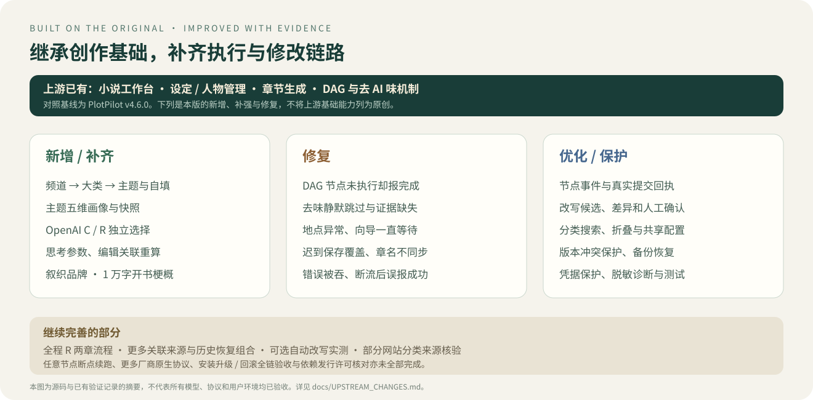
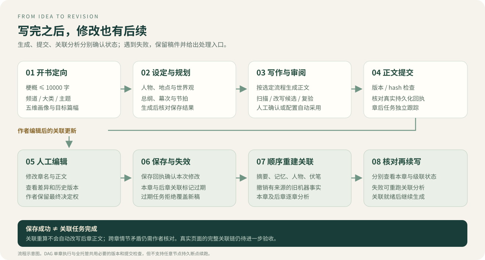

# 叙织与上游版本的改动对照

核对日期：2026-10-22。基线为 [PlotPilot v4.6.0](https://github.com/shenminglinyi/PlotPilot/tree/v4.6.0)，对应上游提交 `1c481237b6fa32ef5f85d7f8da4cb16f366cd4f0`；独立发行版本为 **TaleWeft 0.1.0-preview.1**，仓库为 [MontellaGreat/TaleWeft](https://github.com/MontellaGreat/TaleWeft)。本文件汇总当前源码和已有专项验证记录；实现、自动测试、真实模型调用、界面流程和安装包验收分别判断。

[返回项目首页](../README.md) · [使用指南](USER_GUIDE.md) · [发布说明](RELEASE_0.1.0-preview.1.md) · [品牌修改声明](../MODIFICATIONS.md) · [恢复说明](RECOVERY_AND_SUPPORT.md)

## 继承的能力

上游已具备小说项目管理、设定库、人物关系、故事结构、章纲与正文生成、DAG、文风扫描与去 AI 味机制，以及模型接入和导出基础。本版继续使用原有架构和技术栈，下列变化是对这些基础的扩展与修复。

## 新增与补齐

| 模块 | 本版调整 | 作者可见的结果 |
| --- | --- | --- |
| 分级分类 | 男频 / 女频 / 双频 → 大类 → 网文主题；当前 21 类、104 主题 | 按层选择、频道内搜索、展开收起；支持自填大类和主题 |
| 主题规则 | 世界观基调、剧情结构、节奏把控、写作风格、特殊要求 | 五项可改，确认后保存独立画像快照、版本和 hash，并用于提示词 |
| 模型协议 | OpenAI C / Chat Completions 与 R / Responses 独立配置 | 用户决定请求哪种接口；显式 R 失败不会静默回退 C |
| 思考与能力 | 思考程度、思考预算、top_p、停止序列与输出能力检查贯通配置和 provider | 简化模型引擎可展开“思考程度与推理参数”，完整 AI 控制台也可调；不兼容参数有提示或拒绝 |
| 改写审阅 | 仅扫描 / 作者确认 / 自动采用三种策略，原稿、候选、差异与证据绑定 | 作者可以核对、确认、拒绝或重新生成候选 |
| 章节编辑 | 章名和正文共同保存与版本化，历史恢复、差异、保存回执 | 结构树同步章名；冲突时保护本地稿，不让迟到结果覆盖新稿 |
| 关联任务 | 保存后标记本章及后章关联过期、顺序重算，支持任务重试 | 查看本章与后章级联状态，重跑章后关联分析 |
| 数据管理 | 带校验的 JSON 稿件迁移、保护快照、备份与恢复流程补强 | 预览后导入新书，避免覆盖原书；恢复先在独立副本验证 |
| 独立品牌 | 叙织 · TaleWeft，独立图标、应用标识、数据目录与启动入口 | 与上游安装隔离，原版权与持久数据契约保留 |
| 本次梗概扩容 | 新建书目上限由 2000 提升到 10000 字 | 页面计数和输入限制、API 上限与说明一致；不会截断到旧上限 |
| 作者书桌 | 书库、三步新建、全局导航、纸张正文、章节搜索、九资料入口、专注、主题与窄屏布局 | 复用原业务组件，保留规划、设定、审阅、工作流、模型和提示词操作；接入正式「织页书标」 |

## 修复的问题

| 原问题 | 修改后的行为 |
| --- | --- |
| DAG 存在反馈循环、非法输入或端口仍尝试运行 | 无环、节点类型、必需输入和端口校验统一；非法图明确拒绝 |
| 节点未执行、失败或下游跳过，整图仍显示完成 | 用真实节点事件、结果和提交状态判断；超时、取消与失败分别记录 |
| 正文能绕过必要审计直接提交 | 生成正文须经过审阅 / 改写门控、版本检查和提交确认；DAG 与托管共用作品租约 |
| 场记与节拍未真正进入正文提示词 | 修复错误服务调用，传递人物、地点、POV 与节拍计划；自定义模板漏槽位也补入 |
| 去味扫描没跑或回执丢失却显示正常跳过 | 串联生成前规则、流式与终态全文扫描、章后审计；缺证据不能判成功 |
| 旧候选或旧声线缓存被当作当前正文结果 | 按正文 hash、revision、运行身份绑定候选、复验与缓存；过期结果拒绝采用 |
| 作者拒绝候选后，在途任务又重新打开候选 | 拒绝与版本状态进入提交检查；确认或拒绝不会自行恢复托管 |
| 地点缺 ID、重复 ID、孤儿或循环导致生成 / 保存异常 | 统一整理 AI 地点树、保留父子层级；空或无效结果失败并保护旧地图 |
| 开书向导在 failed、blocked、cancelled、提交失败后仍转圈 | 读取权威保存终态，释放运行状态、展示错误并允许重试；网络轮询失败有界处理 |
| SSE 断流或读回失败仍提示完成 | 断流与异常传回页面；生成后成功读回保存结果才显示完成 |
| 保存丢包、ABA 编辑或迟到回包误判已保存 | 用单调版本、正文 hash、请求身份与持久回执确认；保存期间继续输入仍显示未保存 |
| 改了章名但结构树 / 历史版本没有对应更新 | 章名进入同一版本保存与恢复流程；旧草稿缺章名时保留当前标题 |
| 本章摘要成功掩盖后续关联分析失败 | 本章与级联状态独立；辅助阶段真实结果、非法回执和失败状态纳入终态判断 |
| 重建索引成功被当作所有关联任务完成 | 先处理必须的章后分析，再更新索引；失败不发布成功缓存 |
| 机器旧事实未撤销，或未来章节污染前章重算 | 按来源撤销旧机器事实、逆序撤销后章投影后顺序重建，并核对版本 / hash |
| 模型地址拼接、旧 SDK 解码与能力查询串档 | 修复 Gemini / Anthropic 地址与 Python 3.14 Responses 解码兼容；迟到能力查询校验档案身份 |
| 错误暴露凭据、诊断留存过量或恢复结果误报 | 补强凭据管理与脱敏、全文记录开关、恢复回执和启动阻断 |
| 新品牌 SVG 与许可路径被后端当成 SPA 首页 | 显式提供 Logo 资源并挂载许可目录；校验 MIME、404 与路径边界 |
| 新版书桌道具仓储、持有人字段与迁移后表结构不匹配 | 统一道具 CRUD 和持有人校验，编辑后重算可更新已登记道具归属 |
| 章末硬状态引文不足导致派生任务与演进快照被阻断 | 最多一次连续扩展原引文的专用修复，锁定事实和章末动作锚点后严格复验；不合格仍失败 |
| 一致性审查将正文人物姓名误判为内部 ID 不匹配 | 统一姓名与实体标识检查，保留真实不一致问题的报告 |
| 严格评分 schema、浏览器存储禁用等导致操作失败 | 修复评分请求结构，并在存储不可用时保持界面可用；补充对应回归 |

## 编辑关联分析的范围

关联任务可重建摘要与 MemoryEngine、机器候选记忆、关系三元组、伏笔、因果与叙事债务、人物状态、对话、时间线、故事线与道具投影、演进快照、向量和实体提及索引。不同任务按版本和来源处理，人工确认、收藏或可识别的人工修改应受到保护。

正文保存只证明稿件已提交。章后分析、本章结果和后章级联都有自己的状态；失败时需要重跑和核对。来源不明的历史内容无法可靠判断是人工还是机器生成，因此不会无条件清除。

例如第一章把“铜钥匙”改为“银钥匙”，重算可以更新相关分析；如果第二章正文仍写“铜钥匙”，其分析可能再次抽出旧事实。当前不会代作者自动改写所有后章正文。

## 验证事实

| 范围 | 已有证据与结论 |
| --- | --- |
| DAG / 去味 | 有节点执行、提交门控、证据与候选生命周期的自动回归，以及真实单章运行记录 |
| C / R 协议 | 两种协议有真实调用通过记录。C 的 API 两章及编辑重算流程有历史通过记录；本轮第三章 R 正文生成 1,223 字符并保存、刷新读回，章后分析切 C 后完成；全程仅用 R 的完整两章流程仍未验收 |
| 章节编辑 | API 与真实页面的章名 / 正文编辑、刷新读回、历史入口与版本留痕有通过记录；全部历史恢复、冲突和跨版本回退组合未逐一人工验收 |
| 编辑后的关联 | 第一章改稿后本章与第二章顺序重算完成，新仓库编号进入记忆，已登记铜钥匙持有人更新为周渡；第三章任务、摘要/记忆与演进快照最终完成；不代表所有关联类型和旧来源组合均已验收 |
| 地点与开书 | 地点整理、状态恢复和层级读写有回归；C 真实开书经过地点阶段，不能反推用户旧卡顿的唯一原因 |
| 构建与安装 | 曾有前端构建、冻结后端、QA 安装启动 / 退出通过记录；升级、回滚、卸载保留数据未全部验收 |
| 本次 1 万字调整 | 新增隔离数据库接口测试：2001 / 10000 字完整保存并读回；10001 字 422 且不创建书目 |
| 本轮作者书桌 | 前端 24 个文件、206 项单元测试与生产构建通过；97 项选定后端回归通过；最终构建后 10 组真实浏览器检查通过，覆盖编辑、历史、九资料入口、DAG 导航、思考设置、主题和窄屏 |
| 真实去味执行 | 第三章五层提示词均已应用，7 个流式窗口与最终全文扫描完成，回执持久化、hash 与保存正文一致；warn 策略、严重命中为零；未覆盖可选自动改写 |

以上为各轮专项验证的事实；本轮作者书桌使用自编测试作品和真实模型调用，不能据此推断全部历史路径、模型或自动流程均通过。自动测试只证明其覆盖范围。

## 尚未完成与使用边界

- **DAG 恢复：**可恢复候选并重新检查，但当前 `can_checkpoint=false`，不支持任意节点持久断点续跑。
- **协议覆盖：**更多厂商的原生适配，以及通用工具调用、多模态、独立 reasoning 事件的完整能力矩阵尚未补齐。
- **真实全流程：**全程仅用 R 的完整两章流程、更多关联数据来源组合和完整安装升级回滚仍需验收。第三章 R 生成与 C 章后分析成功不能合并宣称 R 全流程成功。
- **分类来源：**当前目录并非各网站实时完整分类镜像。起点、纵横、17K 有公开来源映射；番茄、晋江、七猫仍标记为 `pending_source_review`。最近使用与独立关系轴控件亦未完成。
- **生成体验：**地点没有 partial JSON 实时地图预览，也没有统一生成总时限；模型长时间不结束时仍可能等待。
- **文学质量：**五维画像需要作者核对，文风扫描有盲区，去味不保证检测分数或自然度；本轮未真实执行可选自动改写，全书情节一致性需要人工审阅。
- **数据与并发：**来源不明的旧事实不能保证全量清理；每书执行锁主要在进程内，避免多实例调度同书。外部向量库与跨机器凭据有独立恢复边界。
- **发行许可：**保留 Apache 2.0 + Commons Clause。EPUB 已替换为 MIT 许可的 `epublib`，PDF 的 LGPL-3.0-only `fpdf2` 以源码模式打包并附带来源；`THIRD_PARTY_NOTICES/` 收录锁定组件的清单、许可原文和可获得的源码包。lxml Windows wheel 的原生静态依赖仍需要按清单中的精确版本、构建来源和整套扩展替换路径复核，不能只凭 lxml sdist 宣称完成全部重链接义务。

## 维护入口

- 梗概表单：[Home.vue](../frontend/src/views/Home.vue)；API：[novels.py](../interfaces/api/v1/core/novels.py)；边界与落库测试：[test_novel_premise_limit.py](../tests/integration/test_novel_premise_limit.py)。
- 分类源：[builtin_cn_v2.yaml](../shared/taxonomy/builtin_cn_v2.yaml)；交互：[MarketTaxonomyPicker.vue](../frontend/src/components/taxonomy/MarketTaxonomyPicker.vue)。
- 模型完整设置：[LLMControlPanel.vue](../frontend/src/components/workbench/LLMControlPanel.vue)；DAG 接口：[dag_routes.py](../interfaces/api/v1/engine/dag/dag_routes.py)。
- 保存与恢复约定：[RECOVERY_AND_SUPPORT.md](RECOVERY_AND_SUPPORT.md)；系统分层：[ARCHITECTURE.md](ARCHITECTURE.md)。
