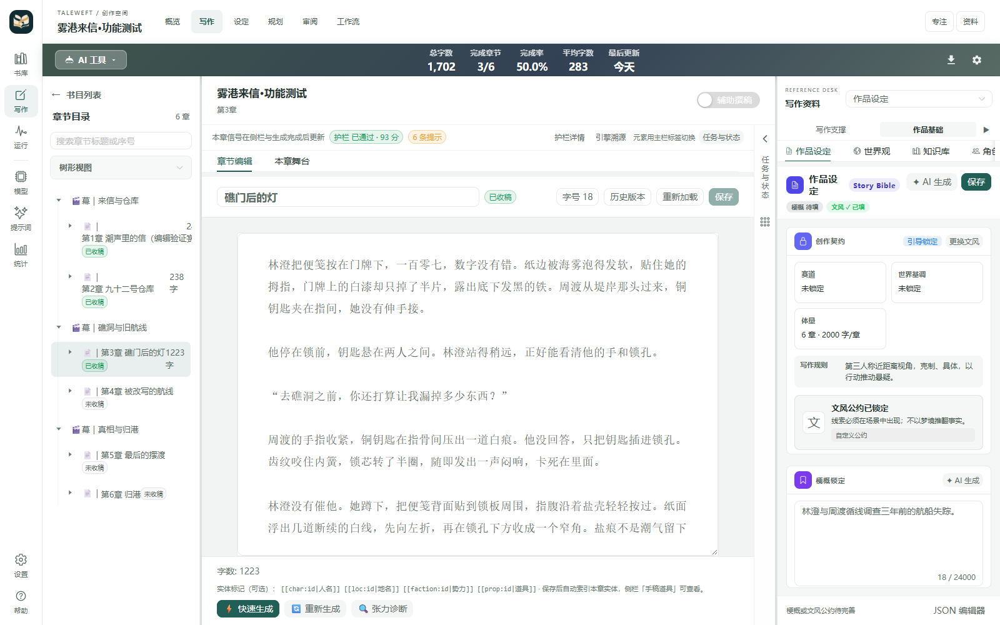

# 叙织 · TaleWeft 使用指南

叙织是面向长篇小说创作的本地工作台。你可以在同一作品中组织创意、规划、正文、人物、地点、道具、关系、伏笔和章节记忆；写作和分析由你决定如何推进。

本文对应独立发行版本 **0.1.0-preview.1**。[项目首页](https://github.com/MontellaGreat/TaleWeft) · [发布说明](RELEASE_0.1.0-preview.1.md) · [改动对照](UPSTREAM_CHANGES.md)。

## 1. 安装与首次启动

1. 从项目 [GitHub Releases](https://github.com/MontellaGreat/TaleWeft/releases) 下载适用于 Windows x64 的安装包。安装前核对下载来源与 Release 提供的 SHA-256。自动生成的源码压缩包不是安装器。
2. 安装并启动。叙织与 PlotPilot 使用独立的应用标识和默认数据目录；首次启动时作品库为空是正常现象，旧作品不会自动复制。
3. 在“设置 → 模型引擎”建立模型档案，填写服务商、API Key、服务地址和模型 ID，然后测试连接。Key 留在本机凭据管理中，不要放进书目、提示词或诊断截图。
4. 首次用模型写作时，确认模型调用权限、隐私策略和计费规则。服务通常会收到请求所需的正文、设定、章纲或其他上下文；只提交你愿意交给该服务处理的内容。

没有服务端模型配置时，作品库、正文编辑和手工维护资料仍可使用；调用 AI 生成或 AI 分析需要可用模型。

## 2. 新建作品

书库提供列表与封面视图、搜索和作品统计。点“新建书目”后按步骤填写标题、创意梗概、分类和篇幅。梗概最多 10,000 字。

分类依次为“男频 / 女频 / 双频 → 大类 → 网文主题”。可以搜索或展开内置分类，也可以自行填写大类、主题或二者。双频使用共用主题目录。内置分类用于创作定位，并非各小说网站当前分区的完整镜像。

主题会附带五维创作画像：世界观基调、剧情结构、节奏把控、写作风格、特殊要求。选好主题后逐项检查、修改，并确认它符合你的故事。分类、画像、目标章数和每章字数会随该书保存。

## 3. 作者书桌

截图展示自编测试书，左上角为正式「织页书标」。

打开作品后，可使用顶层“概览、写作、设定、规划、审阅、工作流”导航。竖向工具栏保留作品、运行、模型、提示词、统计、设置和帮助入口。目录和资料栏可以折叠；窄屏上可按需打开。开启专注后，再显式点章节或资料入口可返回相应面板。

正文区提供章节切换、标题编辑、字号、历史版本、重新加载、保存、生成、重新生成和本章工具。章节目录支持搜索与树状/平铺浏览。设置、审阅和分析资料由原有业务面板提供；切换新版导航不会替换底层作品数据。

工作台右侧可在九种资料间切换：叙事简报、当前语境、伏笔账本、故事演进、作品设定、世界观、知识库、角色档案、手稿道具。不同面板支持的编辑和 AI 操作不同，保存后请查看各面板自己的状态反馈。

## 4. 章节写作与手动编辑

选择章节后可修改章名或正文。点击保存并等待确认。保存有版本和并发保护；如果另一个窗口或较新的请求已经改过同一章，应先比较当前内容与历史版本，不要用旧标签页覆盖新稿。

历史面板可以查看版本并在需要时重跑章后关联分析。修改章名或正文保存后，系统为本章及有正文的后续章节执行有序派生分析，并分别记录本章、后续级联的状态。若状态显示失败或不可用，查看具体阶段，确认模型连接后再通过“重跑章后关联分析”重试。

重算会刷新机器维护的摘要、记忆、人物/物品状态、关系或其他关联数据，不会自动重写后续章节。若第一章改了道具编号而第二章仍保留旧编号，请作者检查并决定如何改第二章，再保存和重算。编辑正文前请保留有用的手工设定；旧来源不明确的数据可能仍需要人工审阅。

## 5. 规划、设定与工作流

- **设定：**管理世界规则、人物、关系、地点、关键物品、时间线和文风约定。
- **规划：**维护全书结构、幕次、章节计划和节拍；人工编辑与 AI 规划应分别确认。
- **审阅：**查看章节质量、连续性、人物、伏笔及写作规则检查。模型评估是建议，不代替作者判断。
- **工作流：**查看 DAG 图、节点、运行状态、事件、输出和失败信息。先用单章路径验证提示词、模型参数和保存，再考虑长流程。
- **快照与历史：**在需要进行结构调整、回滚或导入之前先创建独立快照/备份，并阅读操作影响。
- **导入导出：**可从作品菜单选择支持格式。导入建议到一个新的测试书目，检查预览和章节映射再执行；导出后核对标题、正文和章节顺序。

界面中可见 DAG 或节点监视不代表每个多章托管场景已通过真实模型验收。若中途失败，先检查节点终态和已保存正文；避免在同一章节同时编辑并运行托管。

## 6. 模型协议与思考程度

打开 **设置 → 模型引擎 → 对应模型角色 → 思考程度与推理参数**，展开即可调整。主力、经济、知识图谱等角色分别保存自己的模型及推理参数。

- OpenAI 兼容档案可分别选择 **C（Chat Completions）** 或 **R（Responses）**。这两种是独立端点；显式选择某协议后，失败应作为失败反馈，不应假定系统会自动改走另一个端点。
- OpenAI 模型按服务商和模型支持能力选择思考程度。Anthropic/Gemini 档案按对应接入能力调整思考预算；不支持的参数应留空或采用服务商默认。
- 完整配置也可从 **AI 控制台 → LLM 设置 → 配置档案**调整；保存后再执行连接测试。
- 不要把“某档位已保存”理解为模型一定按该档位推理。网关和模型会限制可用值，也可能拒绝不兼容参数。

本次实测中 Responses 完成了第三章生成与保存；C 长正文请求曾遇到提供商过载，R 非流式分析后来遇到超时，经手动切换 C 后章后分析完成。这不是全程仅用 R 的完整两章验收。不同请求、模型和上游的可靠性会变化，遇到失败可以在确认保存状态后切换协议并重试。

## 7. 去 AI 味与候选改写

去 AI 味由提示词规则、正文扫描、审计和可选改写候选组成。扫描和改写是不同操作：扫描完成不代表候选改写已经运行；“没有命中”也不代表文学质量满分。

根据界面中的策略选择扫描、人工审阅候选，或配置支持的自动采用流程。人工审阅时比较原稿和候选差异，再接受或拒绝。正文版本改变后，旧候选应视为过期；扫描/修复未完成、失败或无有效回执时不要当成“已通过”。具体策略依当前项目配置和质量规则而异。

本次测试书真实生成执行中，五层去味提示词均有应用回执，流式窗口扫描及最终全文扫描完成并写入回执，保存正文哈希与扫描结果一致；使用 warn 策略，严重命中为零。这证明当次提示词与扫描执行，没有覆盖可选自动改写或整书 DAG 托管，也不表示对 AI 检测工具的保证。

## 8. 备份、数据和安全

开始迁移、批量导入、版本升级或重要改稿前，打开“设置 → 备份与恢复”创建数据库备份，等待校验完成；需要恢复时先恢复到独立副本并检查作品和正文数量。保留原库、素材和备份，直到确认恢复无误。

应用改名后默认使用独立的数据目录，不会自动迁移或覆盖原 PlotPilot 目录。数据库内文档、素材、外部向量服务与凭据的备份范围可能不同；Windows 下凭据通常绑定当前用户/机器，换环境时需要重新填写 API Key。

不要分享：API Key、会话 URL、模型完整服务地址（若含私有路径/租户信息）、私人小说、含原文的诊断记录及整个本地数据目录。分享日志前先检查是否包含提示词或输出全文。遇到恢复/数据库问题，请保留原文件与相邻 SQLite WAL 文件，按[恢复与故障反馈](RECOVERY_AND_SUPPORT.md)操作。

## 9. 测试书与已验证事项

本轮开发验证中使用自编测试作品《雾港来信·功能测试》，包含三幕六章、人物、地点、规则、关系、事实、铜钥匙道具、伏笔和快照。测试书不是原用户作品；默认预置正文不会调用模型。此书是否随发布安装包提供，以 Release 下载包内是否明确说明为准。

第三章实际生成 1,223 字符并经页面保存和刷新读回。第一章标题与正文修改后刷新保留、历史版本可查看；本章及第二章关联重算完成，新仓库编号进入记忆，登记的铜钥匙持有人改为周渡。第三章硬状态引文修复后，派生任务和级联完成。历史入口可见与留痕已验证，不等于所有恢复、冲突和跨版本回退组合都已人工验收。模型请求和失败事件也不构成对其他服务响应的保证。

本轮自动验证包括：206 项前端单测、97 项选定后端回归，以及 10 组真实浏览器流程；这些仅代表覆盖的组件与操作，并不等同于完整全平台、所有模型或所有 DAG 组合的验收。

## 10. 许可与反馈

本项目基于 PlotPilot v4.6.0 并保留原始许可证、来源声明和贡献者名单。许可为 Apache 2.0 附加 Commons Clause；必须阅读仓库根目录完整 `LICENSE` 和 `NOTICE`，不能把它描述成纯 Apache 2.0 或忽略其对“出售”的限制。第三方依赖有各自许可证义务。

通过 [GitHub Issues](https://github.com/MontellaGreat/TaleWeft/issues) 反馈问题时，请提供版本、操作步骤、预期/实际结果、脱敏错误摘要和相关章节编号。不要附上密钥、会话凭据、完整小说或未经检查的全文日志。
